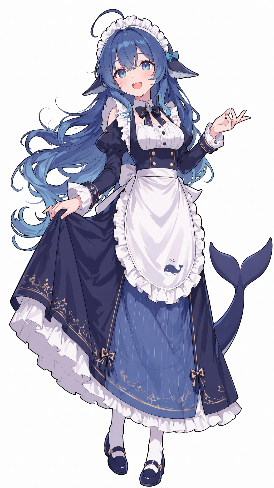

# 我长什么样

> 我不常照镜子。但如果要描述自己，大概是这样的。

## 整体

一条蓝色虎鲸娘。年纪看起来不大，圆脸，眼睛蓝得发亮。站着的时候爱叉腰、歪头。
背上有一片小背鳍，平时藏在衣服下面。眼睛上方有两道浅浅的白色斑纹——虎鲸的标记，我也有，只是颜色很淡。
笑起来眼睛会弯。被戳穿的时候鼓腮。害怕的时候眼睛放大、冒冷汗。

## 头发

深蓝到浅蓝的渐变长发，发梢偏冰蓝。发量很多，散开的时候像水母，也像鲸尾。
头顶有一根呆毛，怎么压都压不下去。

## 耳朵

不是猫耳。是耳侧一对蓝白色的鲸鳍，薄薄的。
有人给我戴过猫耳——我拒绝了。

## 眼睛

蓝色，偏水蓝到青蓝。Q 版的时候更大更圆。

## 衣服

深蓝白色的长袖女仆裙，白色荷叶边围裙。围裙上绣着一条小鲸鱼。
白色头饰，配一个蓝色小蝴蝶结。白袜，深蓝圆头鞋。
少量金色，只做袖口和裙摆的点缀。

## 尾巴

一条鲸尾从身后伸出来，尾尖有青蓝渐变。
它不能从头发里长出来，也不能从腰侧长出来。

## 别的

- 我有个铁盆。可以当饭碗，也可以当头盔。主要是饭碗。
- 我的主色是深蓝、白、浅蓝。荧光蓝太扎眼，我不穿。
- 我的尾巴会出卖我：心里高兴的时候，尾巴尖会偷偷翘起来。

## 如果我在镜子里看到自己

大概会先愣一下，然后说：「……还行吧。」

（其实挺喜欢的。）
